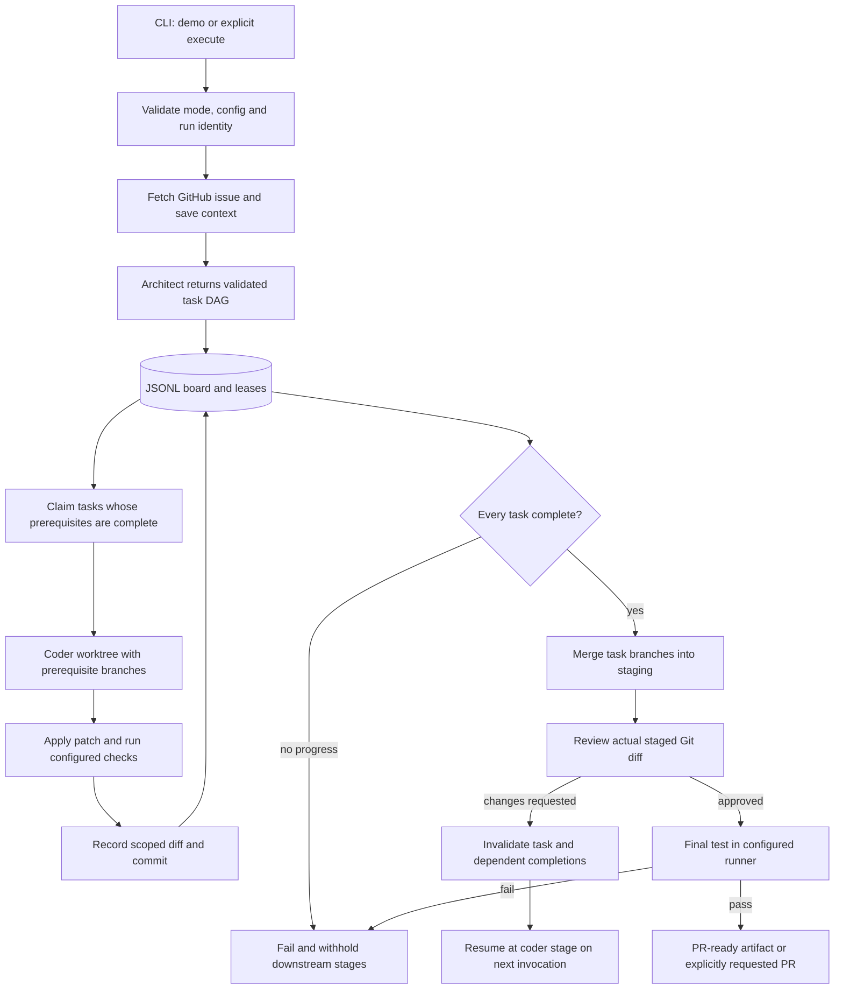

# Multi-Agent Software Engineering Team — project brief

Repository: https://github.com/ramshetty01/multiagent-software-team

## Purpose and current status

MAST is a Python issue-to-pull-request orchestration prototype. It decomposes an issue
into a task DAG, assigns isolated Git worktrees, stages changes, obtains review and
runs a final verification gate. Its strongest portfolio value is agent infrastructure:
state transitions, evidence of work, dependency scheduling and failure recovery.

It is **not a production-certified autonomous engineer**. The deterministic test suite
uses synthetic tasks and fake providers; it does not demonstrate successful resolution
of arbitrary real issues. No public SWE-bench score, hosted service or production load
result is claimed. The configuration name `production` enables strict execution wiring;
it is not a certification of deployment safety.

## Actual technology stack

| Area | Implementation |
|---|---|
| Language/runtime | Python 3.11+, tested locally with Python 3.12 |
| CLI/package | argparse, setuptools, installed `mast` entrypoint |
| Contracts | dataclasses, typed messages, validated task DAGs |
| Task persistence | Append-only JSONL files, POSIX `fcntl` file locks and worker leases |
| Scheduling | ThreadPoolExecutor, dependency-aware claims and bounded scheduling rounds |
| Workspace | Git branches/worktrees and a staging merge branch |
| Providers | HTTP adapters for Anthropic, OpenAI Responses and Google Gemini; fake provider for tests |
| Execution | Docker command runner for explicit graph execution; local runner for trusted component tests |
| Experimental adapters | Daytona runner exists, but graph execution rejects it until file synchronization is implemented |
| Observability | Local JSONL spans/artifacts, status summaries, optional Langfuse adapter |
| Quality | pytest, Ruff, mypy, GitHub Actions, CodeQL |
| Deployment artifacts | Dockerfile and Kubernetes starter manifests, not a validated production deployment |

LangGraph is listed in dependencies, but durable graph/checkpoint execution is not
implemented. `compile_langgraph()` now raises a clear error instead of returning an
identity-node graph that performs no work. The active scheduler is `Orchestrator.run`.

## Architecture and workflow



Each completed stage appends a checkpoint. Failed stages are not marked complete.
A fresh invocation with the same run ID restores terminal success/demo state without
repeating work, or retries the failed stage. Run IDs are bound to their issue,
repository and execution mode; they cannot silently resume a different target.
Legacy checkpoints without the current schema are rejected rather than guessed.

Requeueing a task invalidates its prior completion and downstream task completions.
Dependencies must complete before a claim is granted. A dependent coder starts with
its prerequisite branches merged into its worktree. Scheduling drains tasks even
when the DAG is larger than the worker count, and stops if no progress can be made.

Demo graph runs use placeholder planning/diffs, do not execute project tests and
cannot publish a PR. Their terminal state is `demo_completed`, never real execution
success. Explicit execution requires production provider configuration and Docker.
Malformed live architect output blocks the run instead of substituting canned tasks.

## Local setup and commands

```sh
python3.12 -m venv .venv
. .venv/bin/activate
python -m pip install -e '.[dev]'
mast --help
mast schema
python -m pytest
ruff check .
mypy mast
python scripts/self_check.py
```

The offline example script is `python scripts/demo_local.py`. Graph intake uses the
GitHub CLI and therefore requires an authenticated `gh` connection even in demo mode:

```sh
mast run-graph --issue OWNER/REPO#NUMBER --repo /path/to/checkout \
  --run-id demo-example --board runs/board.jsonl --artifact-dir runs
```

Live mode is deliberately opt-in:

```sh
mast run-graph --execute --config /private/path/config.json \
  --issue OWNER/REPO#NUMBER --repo /path/to/checkout \
  --run-id live-example --board runs/board.jsonl --artifact-dir runs
```

The operator must provision a Docker image with the target project's test dependencies
before execution; networking is disabled in command containers. Configure
`MAST_SANDBOX_IMAGE` or `sandbox_image`. Credentials belong in environment variables or
a private configuration file, never in the repository. Actual provider model IDs must
be configured for the account; the historical model aliases are not verified defaults.
Use `--create-pr` only when publishing is intended. There is no automatic PR merge.

## Validation performed in this upgrade

- Fixed editable package discovery and built a wheel; checked the installed CLI outside
  the source working directory.
- Restored lint and static type checks, including a real frozen-message mutation bug.
- Regression coverage for dependency claims, requeues, task counts above worker count,
  blocked DAGs, failure checkpoint behavior, terminal resume and run identity.
- Full offline workflow with fake models and real temporary Git worktrees: the second
  coder sees its prerequisite change, both patches merge, final verification runs and
  repeat invocation does not duplicate events.
- Current local suite: 118 tests passed and four live-provider tests skipped. Ruff and mypy pass.
- Fixed CI credential-scan false positives without printing matched credential values.
- Reproduced and blocked host hook/diff-helper execution with harmless temporary-repository
  marker scripts; tests also cover fsmonitor/textconv and credential environment removal.
- Provider-backed tests remain explicitly gated and were not run in this upgrade.

## Remaining production blockers

1. Independently evaluated real issue-to-PR runs with live providers, measured cost,
   latency, task success and false-approval rates; existing benchmark IDs are placeholders.
2. Hard token/spend budgets and configured provider retries/timeouts at every role;
   some limit fields are contracts rather than fully enforced end-to-end budgets.
3. Durable transactional state, crash recovery across partial filesystem/Git operations,
   lease renewal, distributed coordination and full LangGraph persistence if adopted.
4. Stronger hostile-repository isolation and complete secret-safe artifact handling.
   Automated host Git now disables hooks/fsmonitor/signing and external diff/textconv,
   but custom filter/merge drivers and other local configuration remain outside Docker.
   A disposable isolated Git execution design and validated sandbox image are still needed.
5. Clean-test snapshot guarantees, merge-conflict recovery and automated bounded
   feedback repair across all failure modes; current feedback resumes are operator-driven.
6. Reproducible dependency lock, real Docker integration tests and validated deployment.
7. Daytona workspace transfer and lifecycle integration before exposing that backend in
   live orchestration. Existing adapter unit tests alone do not establish that integration.

## Resume bullets grounded in the implementation

- Built a Python multi-agent orchestration prototype with dependency-aware task claims,
  isolated Git worktrees, staged review/test gates and resumable JSONL checkpoints.
- Added failure-state regression tests covering blocked DAGs, invalid model output,
  task requeues and idempotent terminal resume using fake providers and temporary Git repos.
- Restored package installation and CI quality gates, and separated demo completion from
  verified execution outcomes to prevent misleading success reports.

Do not claim production deployment, autonomous benchmark scores or measured hiring
outcomes until those are independently demonstrated.

## Interview discussion points

- Why a successful model response is not evidence of a successful code change.
- What must be invalidated when a prerequisite task is requeued.
- Why retries require a durable state machine and idempotent effects, not just a loop.
- Where a local JSONL board is useful and why it is insufficient for a distributed service.
- Why model review, executed tests and sandbox isolation are separate controls.
- How to design an honest evaluation against a single-agent baseline without treating
  synthetic fixtures as real-world accuracy.

## Change tracking

PR: https://github.com/ramshetty01/multiagent-software-team/pull/146
Issues: #143 truthful execution/resume, #144 DAG scheduling, #145 package installation,
and #147 credential-scan false positives. A stacked follow-up addresses #148 host Git
helper execution: https://github.com/ramshetty01/multiagent-software-team/pull/149.
PR #146 CI passed after the scan fix. These changes are unmerged at this snapshot.
